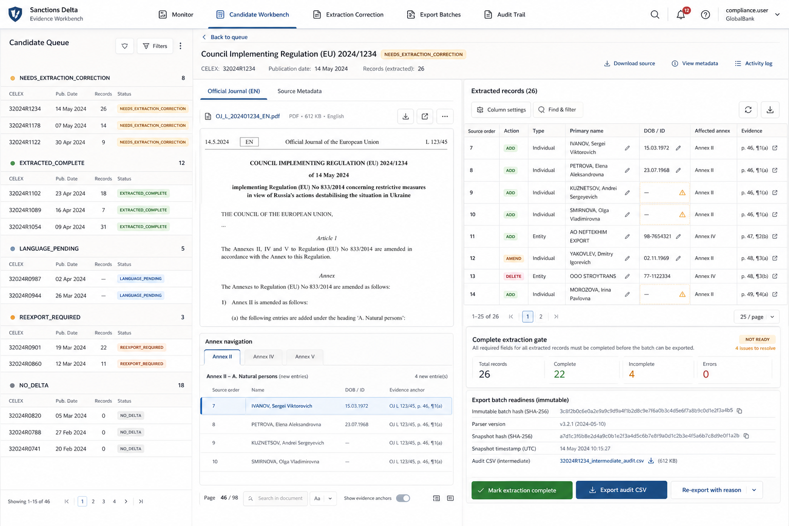

# Dashboard UI Brief

## Preferred Design Direction

Use the Evidence Workbench concept as the primary visual direction for MVP implementation:

The dashboard should feel like a serious bank compliance workbench: dense, quiet, document-centric, and built around candidate legal acts rather than record approval queues.

Core layout principles:

- Use top-level navigation for Monitor, Candidate Workbench, Extraction Correction, Export Batches, and Audit Trail.
- Make the candidate legal act queue the primary navigation surface.
- Use a three-pane workbench for candidate detail and correction: candidate queue, official English source/evidence viewer, and extracted records/export readiness panel.
- Show source order, source location, affected Annex, evidence text, parser version, snapshot hash, and complete-extraction gate status close to the extracted records.
- Do not include approve/reject controls or per-record review statuses.
- Keep visual density high with compact tables, status chips, segmented filters, and restrained color.
- Avoid landing-page composition, decorative gradients, oversized cards, or marketing-style hero sections.

## Screen 1: Monitoring Overview

Purpose: show whether the hourly monitoring process is healthy.

Cards:

- Last successful run
- Candidates detected today
- Candidates needing extraction correction
- Complete extractions ready for export
- Export batches created today
- Failed retrieval/parsing

Table:

- Run time
- Source/feed
- Items seen
- New candidates
- Errors
- Status

## Screen 2: Candidate Legal Acts

Purpose: list all detected candidate documents.

Columns:

- Detected time
- Publication date
- CELEX ID
- Title
- Feed/query
- Classification
- Annex found
- Extracted records count
- Status

Filters:

- Date range
- Feed/query
- Status
- Annex found
- Has extracted records

Actions:

- View candidate
- Reprocess
- Confirm no delta

## Screen 3: Candidate Detail

Purpose: allow analyst to inspect one legal act.

Sections:

- Metadata: CELEX, title, publication date, source URL
- Classification result
- Annex evidence snippet
- Extracted records table
- Raw document link/reference
- Processing logs

Actions:

- Mark extraction complete after correction
- Export complete extraction
- Re-export with reason
- Reprocess

## Screen 4: Extraction Correction

Purpose: correct extracted persons/entities when the candidate legal act does not yet have a complete extraction.

Fields:

- Record type: person/entity
- Action type: add/amend/remove/replace
- Primary name
- Aliases
- Date/place of birth
- Nationality
- Identifiers
- Grounds/reasons
- Evidence text
- Confidence score

Actions:

- Edit/correct
- Add missing extracted record
- Add correction note
- Mark candidate extraction complete

## Screen 5: Export Center

Purpose: create and download CSV files.

Features:

- Show candidate legal acts with complete extraction and no export batch.
- Generate one audit CSV for a complete candidate legal act.
- Show previous export batches.
- Download previous exports.
- Re-export a candidate legal act with a required reason.

## Prototype Ideas

Implement against the Evidence Workbench direction first. If additional prototypes are useful later, compare them against this baseline:

1. Operations dashboard with status cards and candidate table.
2. Candidate detail view with Annex evidence side panel.
3. Extraction correction workflow with editable extracted fields and complete-extraction action.

Watch query and configured base act management is out of scope for the MVP dashboard.
